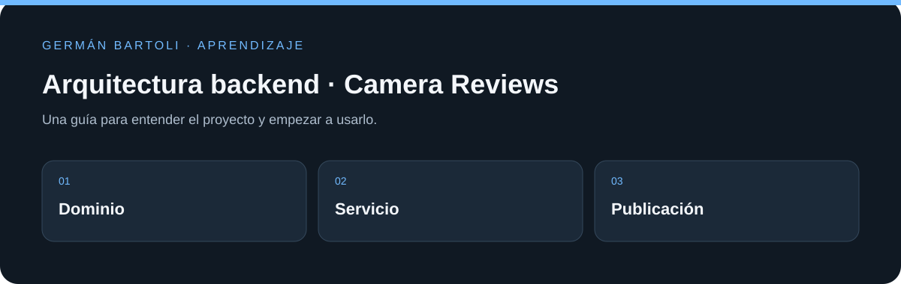

# Arquitectura backend · Camera Reviews

**Práctica de arquitectura para reseñas de cámaras, con modelos, servicio de contenido, pruebas y una función de publicación.**

[Empezar](#primeros-pasos) · [Mapa del repositorio](#mapa-del-repositorio) · [Autoría](#autoría-de-esta-documentación)

*Esquema de orientación; no representa una captura de la aplicación.*

## Primeros pasos

1. Abrí `CameraReviewsBackend.sln` y recorré primero el modelo `CameraReview/`.
2. Revisá `CameraReviewUnitTests/` para comprender los contratos antes de configurar servicios externos.
3. Los proyectos principales declaran `netcoreapp3.1`; prepará un entorno compatible. El texto original del curso se conserva como referencia, con su autoría original.

## Entorno de aprendizaje

Este repositorio conserva ejercicios y versiones de su etapa de estudio. Revisá los archivos de proyecto para preparar el SDK, runtime o servidor correspondiente; esta actualización del README no migra dependencias ni acredita una ejecución reciente de todos los ejemplos.

## Anuncio de lanzamiento
Al dia martes Diciembre/29/2020 se lanza el curso practico de Backend.
Estoy muy entusiasmado de compartir con ustedes este repositorio donde se encontrara codigo plantilla visto en el curso, asi como algunos articulos que podran utilizarse para complementar el contenido en video.

Quiero compartirles que, previo al lanzamiento del curso, este repositorio estaba configurado como privado, lo cual desafortunadamente inhabilitaba el uso de Wikis. El uso de la Wiki es una forma en la quiero complementar la documentacion que encontraras aqui, por lo cual te pido un poco de paciencia para configurarla durante estos primeros dias que ya se hace publico el repositorio, y se tiene acceso a este feature en GitHub.

El enlace a la Wiki podra encontrarse aqui -> https://github.com/jorgevgut/curso_backend_platzi/wiki

## Premisa
Este no es un Curso "Receta", desde el dia 1 quiero dejar bien claro que la idea del curso es que el estudiante desarrolle sus habilidades de manera original haciendo practica de lo que se esta recomendando en el "contenido", pero el verdadero aprendizaje esta bajo el control del "estudiante". Esto quiere decir que no es un curso en el que como maestro voy a darte una "repsuesta correcta", lo que brindo es orientacion, y cedo la libertad total de desarrollar el proyecto a como el estudiante lo desee. Por ejemplo, si deseas hacer el proyecto en JavaScript, Java, C#, Go, Rust, C++, Ruby, o Mario Maker, adelante, solo soy un creador de contenido y un ingeniero mas como tú, lo diré desde el inicio y con la mejor intención. No soy "papá de nadie" para hacer la tarea y obtener un diploma como reconocimiento. El verdadero valor de este curso tiene que extraerse a través de la practica y la investigación que demuestran lo que un ingeniero profesional debe de realizar en un trabajo real, resolviendo problemas reales. Y tomarselo en serio es el primer paso.
Para aquellos que no me conocen, comparto un poco de lo que aprendi despues de trabajar para Intel, Wizeline, Amazon y Microsoft, los ingenieros de software que van iniciando su carrera, y que en empresas tipo "Top Tech", FAANG, Big 4, etc.. se considera que ya son buenos programadores desde el nivel 1 en el dia 1, sin embargo para subir a los siguientes niveles se espera que demuestren independencia, desarrollo de conocimiento rapído, capacidad de analisis, y diseño de sistemas. En el primer nivel de ingenieria de software es normal que se espere que todavía se le diga al ingeniero que debe hacer, e incluso tener supervisión de ingenieros mas "senior", a medida que se crece, se gana esa independencia, y se tiene mas impacto y menos supervisión. Este curso va a dirigido a personas que quieran poner a prueba, y desarrollar esa independencia.

## Links

Creación del documento de diseño Clase 9 / 25

https://sequencediagram.org/

https://www.drawio.com/

## Mapa del repositorio

- [CameraReview/CameraReview.csproj](<CameraReview/CameraReview.csproj>)
- [CameraReviewContentProviderService/CameraReviewContentProviderService.csproj](<CameraReviewContentProviderService/CameraReviewContentProviderService.csproj>)
- [CameraReviewUnitTests/CameraReviewUnitTests.csproj](<CameraReviewUnitTests/CameraReviewUnitTests.csproj>)
- [LICENSE](<LICENSE>)

## Autoría de esta documentación

Repositorio mantenido por [Germán Bartoli](https://github.com/GermanBartoli). Guía revisada y actualizada con **Codex**, coautor de esta actualización documental. Los autores, colaboradores, licencias y recursos de terceros conservan sus créditos originales.

Los commits de esta revisión incluyen `Co-authored-by: Codex <noreply@openai.com>`; esta atribución no modifica la autoría del historial anterior.

<!-- firma-german-bartoli -->

  <a href="https://germanbartoli.pages.dev/">
     
    Hecho por Germán Bartoli · Ver portfolio
  </a>

